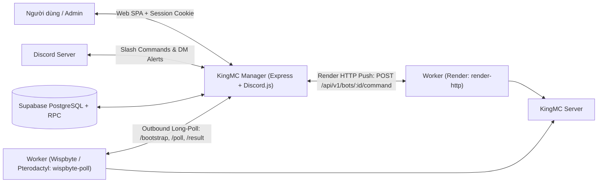

# KingMC Worker Manager (V12.1.1)

**KingMC Worker Manager** là control plane tập trung cho hệ thống bot AFK Minecraft ([BotWorker](https://github.com/kietpro352010/BotWorker)), kết hợp **Web Dashboard SPA**, **Discord Bot (Slash Commands + Interactive Panels)** và **Supabase (PostgreSQL + Atomic RPC)** để quản lý đội Worker, tài khoản Minecraft mã hóa, người thuê bot, lịch trình và cảnh báo đa kênh.

---

## Kiến trúc tổng thể



### Hai cơ chế giao tiếp với Worker

1. **Wispbyte / Pterodactyl (`provider: wispbyte`, transport `wispbyte-poll`)**:
   - Phù hợp cho host không mở HTTP port công khai hoặc đi qua proxy panel.
   - Worker chủ động kết nối ra ngoài tới Manager qua `/api/v1/workers/:workerId/bootstrap`, `/poll`, `/result`, `/heartbeat`, `/events`.
   - **Quan trọng:** Trong Manager, để **trống Web URL** (`serviceUrl = ""`) cho Worker Wispbyte. Tuyệt đối không dùng link trang quản trị panel (`https://wispbyte.com/client/servers/...`) làm URL điều khiển HTTP Push vì panel sẽ trả về HTTP `405 Method Not Allowed`.
2. **Render (`provider: render`, transport `render-http`)**:
   - Manager gửi lệnh trực tiếp qua HTTPS tới `POST <serviceUrl>/api/v1/bots/:workerId/command` (xác thực `x-worker-secret` / `x-manager-bot-id`).
   - Worker vẫn báo trạng thái/sự kiện về Manager qua `/bootstrap`, `/heartbeat`, `/events`.

> Manager V12.1.1 tự động nhận diện link panel `wispbyte.com/client/servers/...` để chuyển sang chế độ `wispbyte` Pull an toàn và tự động đồng bộ lại `provider` khi Worker kết nối qua `/poll`.

---

## Yêu cầu hệ thống

- **Node.js**: `>= 22.0.0 < 25.0.0` (theo `engines.node` trong `package.json`).
- **Supabase Project**: có URL HTTPS và server-only secret key (`SUPABASE_SECRET_KEY` / `service_role`).
- **Discord Application / Bot**: token bot hợp lệ và Server Discord quản trị.
- **Repository Worker**: [kietpro352010/BotWorker](https://github.com/kietpro352010/BotWorker).

---

## Biến môi trường

### 1. Biến bắt buộc

| Biến | Mô tả |
|---|---|
| `DISCORD_TOKEN` | Token bot từ Discord Developer Portal. Giữ bí mật tuyệt đối. |
| `SUPABASE_URL` | URL project Supabase dạng `https://<project-ref>.supabase.co`. |
| `SUPABASE_SECRET_KEY` | Server-only Supabase Secret / `service_role` key (`sb_secret_...` hoặc JWT `service_role`). Hỗ trợ tên cũ `SUPABASE_SERVICE_ROLE_KEY`, `SUPABASE_KEY`. Không dùng anon/publishable key trong production. |

### 2. Mã hóa, xác thực Web & bảo mật Discord (`DISCORD-01`)

| Biến | Mức độ | Mặc định / Ghi chú |
|---|---|---|
| `MANAGER_MASTER_KEY` | **Rất nên đặt** | Khóa AES mã hóa thông tin Minecraft, secret worker, SOCKS5 proxy, token tích hợp (`MANAGER_ENCRYPTION_KEY` là alias). Chấp nhận hex 64 ký tự, base64 32 byte, hoặc chuỗi bất kỳ. Nếu bỏ trống sẽ dẫn xuất tạm từ `SUPABASE_SECRET_KEY` (sẽ không giải mã được dữ liệu cũ nếu đổi key Supabase). |
| `MANAGER_MASTER_KEY_PREVIOUS` | Tùy chọn | Khóa cũ dùng khi luân chuyển (rotate) `MANAGER_MASTER_KEY`. |
| `DISCORD_GUILD_ID` | **Khuyến nghị đặt sớm** | ID Discord Server (17–20 chữ số) nơi bot được phép hoạt động. Bắt buộc nếu chưa lưu qua `/admin setup`. |
| `ADMIN_DISCORD_USER_ID` | **Khuyến nghị đặt sớm** | Discord User ID của SuperAdmin (`ADMIN_USER_ID` là alias). Cho phép người này chạy `/admin setup` lần đầu khi chưa cấu hình `DISCORD_GUILD_ID` (`DISCORD-01` fail-closed gate). |
| `DISCORD_CLIENT_ID` | Tùy chọn | Application ID; tự trích xuất từ `DISCORD_TOKEN` nếu bỏ trống. |
| `ADMIN_ROLE_ID`, `USER_ROLE_ID` | Tùy chọn | ID 2 Role khác nhau (17–20 số). Có thể bỏ trống và cấu hình bằng `/admin setup` trên Discord. |
| `ADMIN_USERNAME` | Tùy chọn | Tên đăng nhập Admin Web mặc định: `admin`. |
| `ADMIN_PASSWORD` | Tùy chọn | Mật khẩu đăng nhập Admin Web ban đầu (6–256 ký tự). Có thể thiết lập/đổi sau qua `/admin password`. |
| `MANAGER_SESSION_SECRET` | Tùy chọn | Khóa ký session Web (>= 16 ký tự). Mặc định dẫn xuất từ `encryptionKey`. |
| `CAPTCHA_REQUIRED` | Tùy chọn | Mặc định `true` trong `production`, `false` ở dev/test. |
| `CAPTCHA_SECRET` | Tùy chọn | Khóa ký challenge CAPTCHA (>= 16 ký tự). |

> **Lưu ý lỗi `/admin setup`:** Nếu gặp thông báo *"This manager has not configured an allowed Discord server yet. Only the configured Admin can run /admin setup."*, hãy kiểm tra lại bạn đã thêm `DISCORD_GUILD_ID` và `ADMIN_DISCORD_USER_ID` vào biến môi trường của host rồi khởi động lại Manager trước khi chạy `/admin setup`.

### 3. URL công khai, Tích hợp & Vận hành (Tùy chọn)

| Biến | Mặc định | Mô tả |
|---|---|---|
| `PUBLIC_BASE_URL` | Tự nhận diện | URL HTTPS công khai của Manager (trên Render tự đọc `RENDER_EXTERNAL_URL`). Dùng cho callback Link4M và sinh `.env` mẫu cho Worker. |
| `RENDER_API_KEY` | Trống | Render API Key nếu quản lý/probe/restart Render Services. |
| `LINK4M_REWARD_ENABLED` | `false` | Bật/tắt vượt link nhận giờ thưởng. |
| `LINK4M_API_KEY` | Trống | API Token của Link4M (`LINK4M_API_TOKEN` là alias). |
| `LINK4M_SECRET_KEY` | Trống | Secret xác thực Webhook Postback Link4M. |
| `LINK4M_REWARD_HOURS` | `12` | Số giờ cộng thêm mỗi lượt hợp lệ (1–48). |
| `LINK4M_DAILY_LIMIT` | `2` | Giới hạn lượt vượt link/ngày (1–10). |
| `WISPBYTE_COOKIE` | Trống | Cookie `https://wispbyte.com/client` để tự động giữ phiên tài khoản Wispbyte 14 ngày (có thể thêm nhiều tài khoản qua `/wispbyte add` hoặc `WISPBYTE_ACCOUNTS`). |
| `WISPBYTE_PANEL_URL` | `https://wispbyte.com/client` | URL Client Panel Wispbyte. |
| `WISPBYTE_KEEPALIVE_INTERVAL_MS` | `86400000` (24h) | Chu kỳ ping giữ phiên Wispbyte (60000–604800000 ms). |
| `TELEGRAM_BOT_TOKEN`, `TELEGRAM_CHAT_ID` | Trống | Kênh nhận cảnh báo sự cố hệ thống qua Telegram. |
| `DISCORD_WEBHOOK_URL` | Trống | Webhook Discord nhận cảnh báo hệ thống (cũng cấu hình được trong Web Dashboard). |
| `BOT_EXPIRATION_GRACE_HOURS` | `6` | Số giờ ân hạn sau khi hết hạn gói thuê trước khi hệ thống tự dừng bot an toàn. |
| `WEB_SESSION_TTL_HOURS` | `24` | Thời hạn cookie phiên đăng nhập Web (1–720 giờ). |
| `WORKER_POLL_WAIT_MS` | `25000` | Thời gian giữ kết nối long-poll tối đa từ Worker (1000–30000 ms). |
| `COMMAND_RESULT_TIMEOUT_MS` | `35000` | Timeout chờ Worker trả kết quả lệnh (5000–120000 ms). |
| `OUTBOX_POLL_INTERVAL_MS` | `30000` | Chu kỳ quét outbox / state sync bất đồng bộ. |
| `RAM_WARNING_MB`, `RAM_WATCHDOG_LIMIT_MB` | `280` / `450` | Ngưỡng dọn bộ nhớ Adaptive GC cho Render 512MB. |
| `LOG_LEVEL` | `info` | Mức log (`debug`, `info`, `warn`, `error`). |

---

## Khởi tạo cơ sở dữ liệu Supabase

1. Tạo project mới trên [Supabase Dashboard](https://supabase.com/dashboard).
2. Mở **SQL Editor** và chạy toàn bộ nội dung file [`supabase/setup.sql`](supabase/setup.sql). Script này thiết kế **idempotent & không phá hủy dữ liệu** để tạo/cập nhật bảng (`manager_users`, `manager_workers`, `manager_keys`, `manager_commands`, `manager_settings`, `audit_logs`, `manager_backups`, `link4m_attempts`, v.v.) và các **Atomic RPC** cần thiết cho phân bổ bot, Link4M, và two-phase reset sync.
3. Lấy `Project URL` (`SUPABASE_URL`) và `service_role` / `Secret key` (`SUPABASE_SECRET_KEY`) dán vào biến môi trường của Manager.

> **Cảnh báo:** [`supabase/reset_and_setup.sql`](supabase/reset_and_setup.sql) sẽ **XÓA SẠCH toàn bộ bảng, view và function** của Manager trước khi cài lại từ đầu. Tuyệt đối không dùng để nâng cấp hoặc sửa lỗi hệ thống đang có dữ liệu khi chưa sao lưu.

---

## Cài đặt & Triển khai

### Chạy cục bộ (Local Development)

Tạo file `.env` tại thư mục gốc Manager:

```dotenv
DISCORD_TOKEN=<discord-bot-token>
DISCORD_GUILD_ID=<discord-server-id>
ADMIN_DISCORD_USER_ID=<your-discord-user-id>
SUPABASE_URL=https://<project-ref>.supabase.co
SUPABASE_SECRET_KEY=<supabase-service-role-or-secret-key>
MANAGER_MASTER_KEY=<chuoi-ma-hoa-on-dinh-sao-luu-ky>
ADMIN_PASSWORD=<mat-khau-admin-6-den-256-ky-tu>
PUBLIC_BASE_URL=http://localhost:3000
NODE_ENV=development
```

Cài đặt và khởi chạy:

```bash
npm ci
npm start
```

Mặc định chạy tại `http://localhost:3000` (hoặc theo `PORT`).

### Triển khai trên Render (Production)

1. Tạo **Web Service** mới trỏ tới repository Manager (`main`).
2. Chọn **Node.js 22+**, cấu hình:
   - **Build Command:** `npm ci --omit=dev`
   - **Start Command:** `npm start` *(chạy `node --max-old-space-size=384 src/index.js`)*
   - **Health Check Path:** `/health`
3. Thêm các biến môi trường ở mục **Environment** (`DISCORD_TOKEN`, `DISCORD_GUILD_ID`, `ADMIN_DISCORD_USER_ID`, `SUPABASE_URL`, `SUPABASE_SECRET_KEY`, `MANAGER_MASTER_KEY`, và tùy chọn `ADMIN_PASSWORD`, `LINK4M_*`, `TELEGRAM_*`...).
4. Sau khi Deploy, kiểm tra:
   - `GET /health` -> liveness & cảnh báo degraded (Link4M / Atomic RPC).
   - `GET /ready` (hoặc `/api/ready`) -> kiểm tra kết nối Supabase + Discord Gateway.

---

## Thiết lập ban đầu & Thêm Worker

### Bước 1: Thiết lập Discord & Mật khẩu Admin
1. Chạy lệnh `/admin setup admin_role:@Admin user_role:@Member` trong Discord server đã khai báo `DISCORD_GUILD_ID` (bởi `ADMIN_DISCORD_USER_ID` hoặc chủ server).
2. Nếu chưa đặt `ADMIN_PASSWORD` trong env, chạy `/admin password` trên Discord để đặt mật khẩu tài khoản Web `admin`.
3. Đăng nhập Web Dashboard bằng tài khoản `admin`.

### Bước 2: Đăng ký Worker trong Web Dashboard
Mở modal **➕ Thêm Bot** trên Web Dashboard:
- **Nếu Worker chạy trên Render:** dán URL công khai của Worker (ví dụ `https://kbot-worker-01.onrender.com`). Hệ thống tự sinh ID + Secret cho 2 slot (`WORKER_ID_1`, `WORKER_SECRET_1`, `WORKER_ID_2`, `WORKER_SECRET_2`) và trả đoạn `.env` mẫu.
- **Nếu Worker chạy trên Wispbyte / Pterodactyl:**
  - Có thể gọi API `POST /api/manager/bots` với `{ "provider": "wispbyte", "slots": 2 }` hoặc dán link server Wispbyte — Manager sẽ lưu Worker ở chế độ `wispbyte` Pull (`serviceUrl: ""`), tự sinh cặp `WORKER_ID_1/2` + `WORKER_SECRET_1/2` và tạo sẵn block `.env` gồm `MANAGER_URL`, `WORKER_TRANSPORT=wispbyte-poll`, `WORKER_BOT_COUNT=2`.
  - Dán các biến đó vào `/home/container/.env` trên Wispbyte (xem hướng dẫn chi tiết ở README của BotWorker).
  - Tuyệt đối không đặt link `wispbyte.com/client/servers/...` vào ô URL của Worker trong màn hình **⚙ Sửa Bot**; nếu bot cũ từng gắn nhầm URL này, chỉ cần mở **⚙ Sửa Bot**, xóa trống ô URL rồi bấm Lưu (hoặc để Worker poll một nhịp để Manager tự động sửa `provider` sang `wispbyte`).

### Bước 3: Gán tài khoản Minecraft & Khởi động
1. Vào chi tiết từng Bot trên Web Dashboard để nhập **Username / Password Minecraft**, cấu hình **Spawn Commands**, **Eco Mode**, **Auto-Totem**, **SOCKS5 Proxy** (nếu cần), **Lịch Auto-Chat / Hẹn giờ Bật-Tắt**.
2. Bật Worker: Worker tải cấu hình đã mã hóa qua `/api/v1/workers/:workerId/bootstrap` và sẵn sàng nhận lệnh.

---

## Tính năng chính trên Web Dashboard V12.1.1

- **Quản lý đội Bot & Thuê Bot độc quyền (1-Bot-1-User):** Tạo User, gán bot, đặt giới hạn quyền đổi tài khoản (`allowAccountChange`), tạm khóa kèm lý do, tùy chỉnh hạn thuê / VIP vĩnh viễn, nguyên tắc 1 bot chỉ thuộc 1 user tại một thời điểm.
- **Gia hạn Giftcode & Ân hạn 6 giờ:** Tạo key số ngày hoặc vĩnh viễn, giới hạn số lượt/bot; khi user hết hạn có 6 giờ ân hạn trước khi background sweep gửi lệnh `stop` êm ái và khóa quyền điều khiển.
- **Vượt link Link4M (+12h) & Bảo trì hệ thống:** Tích hợp Link4M API/Postback Webhook và chế độ **🛠️ Bảo trì hệ thống** (khóa thao tác Worker của khách trên cả Web và Discord nhưng vẫn cho gia hạn/xem trạng thái).
- **Remote Window GUI & Inventory 54 ô:** Xem túi đồ, trang bị giáp/offhand, và click trực tiếp menu chest/GUI trong game theo thời gian thực.
- **Cảnh báo & Sao lưu:** Gửi cảnh báo đa kênh (Discord DM, Discord Webhook, Telegram), ghi Audit Logs xuất CSV/JSON, và Backup/Restore toàn bộ registry/users/keys/settings trên Supabase.

---

## Lệnh Discord (Slash Commands)

| Lệnh | Quyền | Công dụng |
|---|---|---|
| `/admin setup` | SuperAdmin / Chủ server | Thiết lập `admin_role`, `user_role`, tùy chọn `admin_user` và đồng bộ slash commands cho Discord server. |
| `/admin password` | SuperAdmin / Chủ server | Thiết lập hoặc đổi mật khẩu Web cho tài khoản `admin` qua modal bảo mật. |
| `/wispbyte list\|check\|add\|remove` | Admin | Quản lý nhiều tài khoản Wispbyte (mã hóa Cookie trong DB) và ping giữ hạn 14 ngày mỗi 24h. |
| `/check` | Admin | Gửi và tự động cập nhật (mỗi 15 phút) bảng theo dõi trạng thái hệ thống All-in-One. |
| `/kbot` | Admin | Liệt kê tất cả máy chủ Discord mà bot đang tham gia. |
| `/login` | Mọi thành viên | Liên kết tài khoản Web Manager với Discord và tự động cấp Role tương ứng. |
| `/logout` | Mọi thành viên | Hủy liên kết tài khoản Web/Discord và thu hồi Role. |
| `/bots` | Thành viên đã `/login` | Mở bảng điều khiển nhanh danh sách bot được cấp (Bật / Tắt / Khởi động lại / Làm mới). |
| `/logs` | Thành viên đã `/login` | Xem nhật ký sự kiện gần nhất của bot (`bot_id`, `lines`). |
| `/help` | Mọi thành viên | Hiển thị hướng dẫn sử dụng các lệnh Discord. |

---

## Kiểm thử (Testing)

```bash
# Chạy toàn bộ unit & integration tests
npm test

# Chạy bộ E2E đầy đủ 7 tiers (mock Supabase, Discord & Worker)
npm run test:e2e -- --all
```

---

## Xử lý sự cố thường gặp

| Triệu chứng | Nguyên nhân & Cách khắc phục |
|---|---|
| `Remote server returned invalid JSON (405)` / `INVALID_WORKER_URL` khi Bật/Tắt bot | Bot bị gắn nhầm `provider: render` với URL panel web (ví dụ `https://wispbyte.com/client/servers/...`) không phải API BotWorker. **Khắc phục:** Mở **⚙ Sửa Bot** -> xóa trống ô URL để chuyển về `wispbyte` Pull mode; nếu Worker Wispbyte đang chạy `/poll`, Manager V12.1.1 cũng tự động sửa lại sang `wispbyte`. |
| `This manager has not configured an allowed Discord server yet. Only the configured Admin can run /admin setup.` | Thiếu `DISCORD_GUILD_ID` hoặc `ADMIN_DISCORD_USER_ID` trong biến môi trường khi chưa có cấu hình `discord_access` trong DB (`DISCORD-01`). Thêm cả 2 biến vào host, restart Manager rồi chạy `/admin setup`. |
| Worker báo `401` hoặc `Lệch Secret Key (409)` | `WORKER_ID_n` hoặc `WORKER_SECRET_n` trên Worker không khớp Manager, hoặc bot đã bị vô hiệu hóa (`enabled = false`). Kiểm tra lại ID/Secret hoặc cập nhật Secret mới trên cả Manager và Worker. |
| Manager báo `ATOMIC_STATE_SYNC_RPC_REQUIRED` / `degraded` ở `/health` | DB Supabase chưa chạy [`supabase/setup.sql`](supabase/setup.sql) bản mới nhất. Chạy lại `supabase/setup.sql` trong Supabase SQL Editor (an toàn, không mất dữ liệu). |
| Không giải mã được tài khoản Minecraft sau khi đổi key | Thiếu hoặc thay đổi `MANAGER_MASTER_KEY`. Khôi phục key cũ hoặc đặt key cũ vào `MANAGER_MASTER_KEY_PREVIOUS` để giải mã chuyển tiếp. |
| `Service Unavailable (503)` với bot Render | Render Free tier đang cold start (~30–50s) hoặc Worker tạm mất kết nối. Chờ 15–30s rồi thử lại. |
