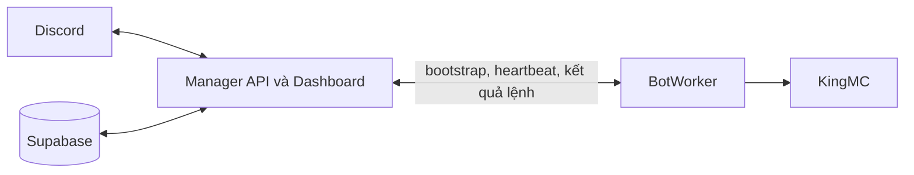

# KingMC Worker Manager

Manager là control plane cho đội Worker KingMC. Dịch vụ kết hợp Discord bot, Web Dashboard và Supabase để quản lý worker, tài khoản, quyền truy cập, lệnh và trạng thái.

## Kiến trúc



Manager cấp thông tin cấu hình cho Worker qua endpoint bootstrap đã xác thực. Worker trên Render có thể nhận lệnh qua HTTP; Wispbyte/Pterodactyl dùng long polling từ Worker về Manager.

## Yêu cầu

- Node.js 20 trở lên.
- Discord application/bot và server Discord để chạy lệnh quản trị.
- Supabase project.
- Repository [BotWorker](https://github.com/kietpro352010/BotWorker) nếu triển khai bot Minecraft.

## Biến môi trường

### Bắt buộc

| Biến | Mô tả |
|---|---|
| `DISCORD_TOKEN` | Token bot lấy từ Discord Developer Portal. Giữ bí mật. |
| `SUPABASE_URL` | URL project, ví dụ `https://<project-ref>.supabase.co`. |
| `SUPABASE_SECRET_KEY` | Server-only Supabase secret/service-role key. Tên cũ `SUPABASE_SERVICE_ROLE_KEY` và `SUPABASE_KEY` vẫn được nhận diện. |

Trong production, không dùng publishable/anon key làm server key. Manager cần quyền backend để lưu dữ liệu hệ thống.

### Bảo mật và thiết lập ban đầu

| Biến | Mức độ | Mô tả |
|---|---|---|
| `MANAGER_MASTER_KEY` | Rất nên đặt | Khóa mã hóa ổn định cho credential Minecraft và secret worker được lưu trong Supabase. Có thể dùng chuỗi riêng hoặc Base64 của 32 byte ngẫu nhiên. |
| `MANAGER_MASTER_KEY_PREVIOUS` | Tùy chọn | Khóa cũ dùng trong giai đoạn chuyển khóa khi dữ liệu hiện có còn được mã hóa bằng khóa cũ. |
| `ADMIN_PASSWORD` | Tùy chọn | Mật khẩu đăng nhập Web admin ban đầu, dài 6–256 ký tự. Có thể khởi tạo bằng `/admin password`. |
| `MANAGER_SESSION_SECRET` | Tùy chọn | Khóa ký session Web; mặc định được dẫn xuất từ khóa mã hóa hiện tại. |
| `DISCORD_CLIENT_ID` | Tùy chọn | Application ID; Manager thử trích xuất từ `DISCORD_TOKEN` nếu bỏ trống. |
| `DISCORD_GUILD_ID` | Tùy chọn | Discord server mục tiêu để đăng ký slash commands. |
| `ADMIN_ROLE_ID`, `USER_ROLE_ID` | Tùy chọn | Có thể đặt cả hai hoặc để trống và cấu hình bằng `/admin setup`. |

Hãy giữ `MANAGER_MASTER_KEY` ổn định và sao lưu an toàn. Nếu đổi khóa mà không cung cấp khóa cũ phù hợp, Manager có thể không giải mã được credential đã lưu. Không commit `.env` hoặc các secret lên GitHub.

Các tích hợp tùy chọn gồm Render API (`RENDER_API_KEY`), Link4M (`LINK4M_API_KEY`/`LINK4M_SECRET_KEY`), Wispbyte (`WISPBYTE_COOKIE`) và Telegram (`TELEGRAM_BOT_TOKEN`/`TELEGRAM_CHAT_ID`). Bỏ trống nếu không dùng.

## Khởi tạo Supabase

1. Tạo project trong [Supabase Dashboard](https://supabase.com/dashboard).
2. Mở **SQL Editor** và chạy [`supabase/setup.sql`](supabase/setup.sql). Đây là schema cài đặt thông thường, hỗ trợ tạo/cập nhật cấu trúc của Manager.
3. Lấy `SUPABASE_URL` và server-only key từ phần API của project; lưu trong Environment Variables của host.

> **Cảnh báo:** [`supabase/reset_and_setup.sql`](supabase/reset_and_setup.sql) xóa bảng, view và function thuộc hệ thống Manager trước khi dựng lại. Script này có lệnh bật cờ reset ngay trong transaction. Chỉ chạy khi bạn chủ động muốn xóa dữ liệu liên quan và đã có bản backup; không dùng cho cài đặt thông thường.

## Chạy cục bộ

Tạo `.env` ở thư mục gốc:

```dotenv
DISCORD_TOKEN=...
SUPABASE_URL=https://<project-ref>.supabase.co
SUPABASE_SECRET_KEY=...
MANAGER_MASTER_KEY=<chuoi-rieng-on-dinh>
ADMIN_PASSWORD=<mat-khau-6-den-256-ky-tu>
```

Sau đó:

```bash
npm ci
npm start
```

Dashboard phục vụ tại `http://localhost:<PORT>/`; cổng mặc định khi chạy cục bộ là `3000`. Đặt `PORT` nếu cổng này đang được dùng.

## Triển khai trên Render

1. Tạo Web Service từ repository `kietpro352010/Manager`.
2. Chọn Node.js 20 trở lên, Build Command `npm ci --omit=dev`, Start Command `npm start`.
3. Thêm các biến bắt buộc và `MANAGER_MASTER_KEY` trong **Environment**. Đặt `ADMIN_PASSWORD` hoặc khởi tạo mật khẩu admin bằng Discord.
4. Đặt Health Check Path thành `/health`.
5. Deploy rồi kiểm tra `/health`, `/ready` và mở Dashboard tại URL dịch vụ.

`/health` báo liveness và cảnh báo degraded; `/ready` (hoặc `/api/ready`) kiểm tra trạng thái phụ thuộc như Supabase và Discord.

## Thiết lập hệ thống và thêm Worker

1. Mở Dashboard Manager và đăng nhập admin. Mật khẩu có thể lấy từ `ADMIN_PASSWORD`; nếu chưa cấu hình, chủ server Discord hoặc SuperAdmin có thể chạy `/admin password`.
2. Chạy `/admin setup` để gán role Admin và User cho Discord server. Có thể đặt `ADMIN_ROLE_ID` và `USER_ROLE_ID` thay thế.
3. Trong khu vực quản trị Dashboard, đăng ký Worker. Lưu lại `WORKER_ID` và secret được Manager cấp.
4. Thêm `MANAGER_URL`, `WORKER_ID_1` và `WORKER_SECRET_1` vào cấu hình dịch vụ BotWorker. Với nhiều slot, thêm cặp biến `_2` tương ứng.
5. Nhập thông tin tài khoản Minecraft và thiết lập worker trong Manager; sau đó deploy/restart BotWorker để nó bootstrap cấu hình.

Worker chạy trên host riêng cần URL Manager có thể truy cập qua HTTPS. Không dùng `localhost` trong `MANAGER_URL` khi Manager và Worker ở hai dịch vụ khác nhau.

## Lệnh Discord

| Lệnh | Công dụng |
|---|---|
| `/admin status` | Tóm tắt sức khỏe, tài nguyên và trạng thái hệ thống. |
| `/admin health` | Kiểm tra chi tiết Discord, Supabase và readiness. |
| `/admin bots` | Xem danh sách Worker với quyền quản trị. |
| `/admin setup` | Cấu hình role Admin/User và SuperAdmin. |
| `/admin password` | Tạo hoặc đổi mật khẩu Web admin. |
| `/bots` | Mở bảng điều khiển Worker theo quyền của người dùng. |
| `/login`, `/logout` | Liên kết hoặc hủy liên kết tài khoản Discord/Web. |
| `/help` | Xem trợ giúp lệnh. |

Slash commands được đăng ký khi bot Discord khởi động. Nếu lệnh chưa hiện, kiểm tra token, quyền bot trong server và `DISCORD_GUILD_ID`.

## Xử lý sự cố

| Triệu chứng | Kiểm tra |
|---|---|
| Manager không khởi động | Xem log biến bắt buộc, Node.js version và kết nối Supabase. |
| Supabase trả lỗi quyền | Dùng server-only key đúng project; chạy `supabase/setup.sql` trong SQL Editor. |
| Worker bootstrap `401` | Kiểm tra worker đã đăng ký/enabled và ID/secret ở Worker khớp với Manager. |
| Worker báo `fetch failed` | Đảm bảo URL Manager công khai, DNS/TLS hoạt động và Worker dùng `https://` trong production. |
| Mất khả năng giải mã credential sau khi đổi khóa | Khôi phục `MANAGER_MASTER_KEY` cũ hoặc cấu hình `MANAGER_MASTER_KEY_PREVIOUS` trong giai đoạn chuyển đổi. |
| Dashboard không đăng nhập được admin | Đặt `ADMIN_PASSWORD` hoặc khởi tạo bằng `/admin password`; kiểm tra service đã tải cấu hình mới. |

## Phát triển

```bash
npm ci
npm start
```

Entry point là `src/index.js`; API, giao diện Dashboard chia module (`src/http/views/dashboard/`), Discord commands, Supabase storage và Worker registry được chia trong `src/`.
