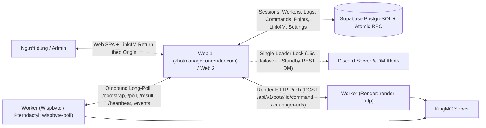

# KingMC Worker Manager (V12.1.1)

**KingMC Worker Manager** là control plane tập trung cho hệ thống bot AFK Minecraft ([BotWorker](https://github.com/kietpro352010/BotWorker)), kết hợp **Web Dashboard SPA** *(Glassmorphism + Animate UI)*, **Discord Bot (14 Slash Commands + Interactive Panels)** và **Supabase (PostgreSQL + Atomic RPC)** để quản lý đội Worker, tài khoản Minecraft mã hóa, người thuê bot, điểm thưởng và cảnh báo đa kênh.

Hỗ trợ chạy **song song nhiều Web Manager (Multi-Web Active/Standby trên Render Free)** dùng chung 1 Supabase — tự đồng bộ dữ liệu, tự failover Discord Leader và tự đưa user Link4M quay về đúng nền tảng web ban đầu.

---

## Kiến trúc tổng thể & Đồng bộ Multi-Web



### Điểm nổi bật của kiến trúc V12.1.1

1. **Đồng bộ 100% qua Supabase (hỗ trợ 2+ Web Render Free chạy song song):**
   - Toàn bộ phiên đăng nhập (`manager_sessions`), tài khoản/quyền (`manager_users`), danh sách & cài đặt Worker + `settingsRevision`, mật khẩu Admin (`admin_credentials`), thông báo (`system_announcement`), bảo trì (`system_maintenance`), webhook (`webhook_settings`), tài khoản Wispbyte (`wispbyte_accounts`), lịch sử log/chat (`bot_chat_logs`), điểm Discord (`discord_points`), lượt Link4M & URL quay về (`link4m_attempt_origins`), và hàng đợi/kết quả lệnh (`manager_commands`) đều lưu tập trung trên Supabase.
   - Khi khách ra lệnh trên Web #2 trong lúc Worker Wispbyte đang long-poll ở Web #1, watcher đa web tự đánh thức poller trong ~2s và đồng bộ kết quả lệnh ngược lại Web #2.
2. **Discord Single-Leader Election & Standby An Toàn:**
   - Web nào giành được lock `discord_gateway_leader` (lease 90s, kiểm tra lại mỗi 15s) sẽ kết nối Discord Gateway xử lý Slash Command và chạy background sweep/maintenance. Web còn lại ở trạng thái Standby (trả `HTTP 200` tại `/ready` để Render giữ xanh) nhưng vẫn cấu hình `client.rest` để gửi DM cảnh báo khi cần.
3. **Link4M Trả Về Đúng Origin Ban Đầu:**
   - Khi user bấm vượt Link4M từ domain nào (Web #1 `https://kbotmanager.onrender.com` hay Web #2), Manager ghi nhận origin thực tế của phiên vượt link (cảnh giác chống giả mạo `X-Forwarded-Host` qua proxy tin cậy) và callback `/api/rewards/link4m/return` trả đúng về web đó. Fallback mặc định: `https://kbotmanager.onrender.com`.
4. **Worker ID-Only & Tự Động Khám Phá Nhiều Manager URL:**
   - Worker không cần khai báo `WORKER_SECRET` hay `MANAGER_URL` cố định; chỉ cần `WORKER_ID_1` (và `WORKER_ID_2` cho Dual-Slot). Manager gửi danh sách `active_manager_urls` qua header `x-manager-urls` sau khi xác thực Worker, giúp Worker tự học và chuyển sang Web dự phòng nếu Web chính hết hạn Free.
5. **Hai cơ chế giao tiếp với Worker:**
   - **`wispbyte-poll` (`provider: wispbyte`):** Phù hợp host không mở port HTTP công khai (Wispbyte / Pterodactyl). Để **trống Web URL** (`serviceUrl = ""`) trên Manager.
   - **`render-http` (`provider: render`):** Manager gọi trực tiếp `POST <serviceUrl>/api/v1/bots/:workerId/command` (gửi `x-manager-bot-id`, tùy chọn `x-worker-secret` nếu Worker có cài).

---

## Yêu cầu hệ thống

- **Node.js**: `>= 22.0.0 < 25.0.0` (theo `engines.node` trong [`package.json`](package.json)).
- **Supabase Project**: URL HTTPS và server-only secret key (`SUPABASE_SECRET_KEY` / `service_role`).
- **Discord Application / Bot**: token bot hợp lệ và Server Discord quản trị.
- **Repository Worker**: [kietpro352010/BotWorker](https://github.com/kietpro352010/BotWorker).

---

## Biến môi trường

### 1. Biến bắt buộc

| Biến | Mô tả |
|---|---|
| `DISCORD_TOKEN` | Token bot từ Discord Developer Portal. Giữ bí mật tuyệt đối. |
| `SUPABASE_URL` | URL project Supabase dạng `https://<project-ref>.supabase.co`. |
| `SUPABASE_SECRET_KEY` | Server-only Supabase Secret / `service_role` key (`sb_secret_...` hoặc JWT `service_role`). Hỗ trợ tên cũ `SUPABASE_SERVICE_ROLE_KEY`, `SUPABASE_KEY`. |

### 2. Mã hóa, xác thực Web & bảo mật Discord (`DISCORD-01`)

| Biến | Mức độ | Mặc định / Ghi chú |
|---|---|---|
| `MANAGER_MASTER_KEY` | **Rất nên đặt (giống nhau trên mọi Web)** | Khóa AES mã hóa thông tin Minecraft, SOCKS5 proxy, Wispbyte cookie, Link4M/Webhook token (`MANAGER_ENCRYPTION_KEY` là alias). Chấp nhận hex 64 ký tự, base64 32 byte hoặc chuỗi bất kỳ. Bắt buộc đồng nhất giữa Web #1 và Web #2. |
| `MANAGER_MASTER_KEY_PREVIOUS` | Tùy chọn | Khóa cũ dùng khi luân chuyển (rotate) `MANAGER_MASTER_KEY`. |
| `DISCORD_GUILD_ID` | **Khuyến nghị đặt sớm** | ID Discord Server (17–20 chữ số) nơi bot được phép hoạt động. |
| `ADMIN_DISCORD_USER_ID` | **Khuyến nghị đặt sớm** | Discord User ID của SuperAdmin (`ADMIN_USER_ID` là alias), cho phép chạy `/admin setup` lần đầu. |
| `DISCORD_CLIENT_ID` | Tùy chọn | Application ID; tự trích xuất từ `DISCORD_TOKEN` nếu bỏ trống. |
| `ADMIN_ROLE_ID`, `USER_ROLE_ID` | Tùy chọn | ID 2 Role khác nhau (17–20 số). Có thể bỏ trống và cấu hình bằng `/admin setup` trên Discord. |
| `ADMIN_USERNAME` | Tùy chọn | Tên đăng nhập Admin Web mặc định: `admin`. |
| `ADMIN_PASSWORD` | Tùy chọn | Mật khẩu Admin Web ban đầu (6–256 ký tự). Có thể thiết lập/đổi sau qua `/admin password`. |
| `MANAGER_SESSION_SECRET` | Tùy chọn | Khóa ký session Web (>= 16 ký tự). |
| `CAPTCHA_REQUIRED`, `CAPTCHA_SECRET` | Tùy chọn | Bật CAPTCHA khi đăng ký (mặc định `true` ở `production`). |

### 3. URL công khai, Tích hợp & Vận hành (Tùy chọn)

| Biến | Mặc định | Mô tả |
|---|---|---|
| `PUBLIC_BASE_URL` | Tự nhận diện theo request (`https://kbotmanager.onrender.com`) | URL HTTPS công khai của từng Web Manager (Render tự đọc `RENDER_EXTERNAL_URL`). |
| `RENDER_API_KEY` | Trống | Render API Key (tùy chọn) để probe/restart Render Services. |
| `LINK4M_REWARD_ENABLED` | `false` | Bật/tắt vượt link nhận giờ thưởng (cũng chỉnh được trực tiếp trên Web Dashboard). |
| `LINK4M_API_KEY`, `LINK4M_SECRET_KEY` | Trống | API Token & Webhook Postback Secret của Link4M. |
| `LINK4M_REWARD_HOURS`, `LINK4M_DAILY_LIMIT` | `12` / `2` | Số giờ cộng mỗi lượt (1–48) và giới hạn lượt/ngày (1–10). |
| `WISPBYTE_COOKIE`, `WISPBYTE_ACCOUNTS` | Trống | Cookie `https://wispbyte.com/client` hoặc JSON đa tài khoản để giữ phiên 14 ngày (khuyên quản lý qua `/wispbyte add` lưu mã hóa trên Supabase). |
| `WISPBYTE_PANEL_URL`, `WISPBYTE_KEEPALIVE_INTERVAL_MS` | `https://wispbyte.com/client` / `86400000` (24h) | URL Panel Wispbyte và chu kỳ ping (tự bỏ qua tài khoản vừa được Web ngang hàng ping `ok` trong 75% chu kỳ). |
| `TELEGRAM_BOT_TOKEN`, `TELEGRAM_CHAT_ID`, `DISCORD_WEBHOOK_URL` | Trống | Kênh cảnh báo sự cố qua Telegram / Discord Webhook. |
| `BOT_EXPIRATION_GRACE_HOURS` | `6` | Số giờ ân hạn sau khi hết hạn gói thuê trước khi tự dừng bot. |
| `WEB_SESSION_TTL_HOURS` | `24` | Thời hạn cookie phiên Web (1–720 giờ). |
| `WORKER_POLL_WAIT_MS`, `COMMAND_RESULT_TIMEOUT_MS` | `45000` / `35000` | Thời gian giữ long-poll Worker và timeout chờ kết quả lệnh. |
| `COMMAND_IDLE_EMPTY_CACHE_MS`, `OUTBOX_POLL_INTERVAL_MS` | `4000` / `30000` | Cache hàng đợi rỗng (4s an toàn đa web) và chu kỳ quét outbox. |
| `RAM_WARNING_MB`, `RAM_WATCHDOG_LIMIT_MB`, `LOG_LEVEL` | `280` / `450` / `info` | Ngưỡng dọn bộ nhớ Render 512MB và mức log. |

---

## Khởi tạo cơ sở dữ liệu Supabase

1. Tạo project mới trên [Supabase Dashboard](https://supabase.com/dashboard).
2. Mở **SQL Editor** và chạy toàn bộ file [`supabase/setup.sql`](supabase/setup.sql) (idempotent, an toàn không mất dữ liệu) để tạo các bảng và **Atomic RPC** (`acquire_manager_lock`, `renew_manager_lock`, `release_manager_lock`, phân bổ bot, Link4M, two-phase reset sync).
3. Lấy `SUPABASE_URL` và `SUPABASE_SECRET_KEY` dán vào biến môi trường của Manager.

> **Cảnh báo:** [`supabase/reset_and_setup.sql`](supabase/reset_and_setup.sql) sẽ **XÓA SẠCH** toàn bộ bảng và function trước khi cài lại. Chỉ dùng khi cần làm mới hoàn toàn sau khi đã sao lưu.

---

## Cài đặt & Triển khai Multi-Web Render

### Chạy cục bộ (Local Development)

```dotenv
DISCORD_TOKEN=<discord-bot-token>
DISCORD_GUILD_ID=<discord-server-id>
ADMIN_DISCORD_USER_ID=<your-discord-user-id>
SUPABASE_URL=https://<project-ref>.supabase.co
SUPABASE_SECRET_KEY=<supabase-service-role-or-secret-key>
MANAGER_MASTER_KEY=<chuoi-ma-hoa-on-dinh>
ADMIN_PASSWORD=<mat-khau-admin-6-den-256-ky-tu>
PUBLIC_BASE_URL=http://localhost:3000
NODE_ENV=development
```

```bash
npm ci
npm start
```

### Triển khai 2 Web song song trên Render Free (Project chính + Project dự phòng)

1. Tạo Web Service #1 (ví dụ `https://kbotmanager.onrender.com`) và Web Service #2 trên 2 tài khoản Render, cùng trỏ tới repo Manager (`main`):
   - **Node.js:** `22` (hoặc `24`)
   - **Build Command:** `npm ci --omit=dev`
   - **Start Command:** `npm start` *(chạy `node --max-old-space-size=384 src/index.js`)*
   - **Health Check Path:** `/ready` (trả `200` cả ở Web Leader lẫn Web Standby)
2. Đặt **giống hệt nhau** các biến `DISCORD_TOKEN`, `DISCORD_GUILD_ID`, `ADMIN_DISCORD_USER_ID`, `SUPABASE_URL`, `SUPABASE_SECRET_KEY`, `MANAGER_MASTER_KEY` trên cả 2 Web Service. Không bắt buộc đặt `PUBLIC_BASE_URL` (Render tự cấp `RENDER_EXTERNAL_URL` riêng cho mỗi web).
3. Kiểm tra sau deploy:
   - `GET /health` -> liveness, RAM và cảnh báo degraded (nếu thiếu RPC hoặc Link4M lỗi).
   - `GET /ready` -> trạng thái Database + Discord (`ready` trên Leader, `standby` trên Web dự phòng).

---

## Thiết lập ban đầu & Thêm Worker (ID-Only)

1. Chạy `/admin setup admin_role:@Admin user_role:@Member` trên Discord server, sau đó dùng `/admin password` nếu chưa đặt `ADMIN_PASSWORD`.
2. Đăng nhập Web Dashboard -> mở modal **➕ Thêm Bot Con**:
   - **Wispbyte (2-in-1 / Pull Mode):** Bỏ trống ô URL -> bấm **Thêm Cụm Wispbyte (2 Bot)**.
   - **Render (Web Service):** Dán HTTPS URL của Render Worker -> tự tạo tối đa 2 slot độc lập.
3. Manager cấp `WORKER_ID_1` (và `WORKER_ID_2`), **không còn yêu cầu `WORKER_SECRET` hay `MANAGER_URL`**:
   ```dotenv
   WORKER_TRANSPORT=wispbyte-poll
   WORKER_BOT_COUNT=2
   WORKER_ID_1=01
   WORKER_ID_2=02
   NODE_OPTIONS=--max-old-space-size=400
   ```
4. Vào chi tiết từng Bot trên Web Dashboard để nhập **Username / Password Minecraft**, **Spawn Commands**, **Eco Mode**, **Auto-Totem**, **SOCKS5 Proxy**, **Lịch Auto-Chat / Bật-Tắt**.

---

## Lệnh Discord (14 Slash Commands)

| Lệnh | Quyền | Công dụng |
|---|---|---|
| `/admin setup` | SuperAdmin / Admin | Thiết lập `admin_role`, `user_role`, tùy chọn `admin_user` và đồng bộ slash commands cho server. |
| `/admin password` | SuperAdmin / Admin | Thiết lập hoặc đổi mật khẩu Web cho tài khoản `admin` qua modal bảo mật. |
| `/wispbyte list\|check\|add\|remove` | Admin | Quản lý đa tài khoản Wispbyte (mã hóa Cookie trên Supabase) và ping giữ hạn 14 ngày mỗi 24h. |
| `/check` | Admin | Gửi và tự cập nhật (15 phút/lần) bảng trạng thái toàn hệ thống. |
| `/kbot` | Admin | Liệt kê các máy chủ Discord bot đang tham gia. |
| `/diemadmin cong\|tru\|dat\|reset` | Admin | Cộng, trừ, đặt mức hoặc reset điểm tích lũy / chuỗi điểm danh / tin nhắn thành viên. |
| `/login` | Mọi thành viên | Liên kết tài khoản Web với Discord và tự đồng bộ Role; nếu đã đăng nhập sẽ báo rõ trạng thái kèm nút **Đăng xuất** 1 chạm. |
| `/logout` | Mọi thành viên | Hủy liên kết tài khoản Web/Discord và thu hồi Role tương ứng. |
| `/bots` | Thành viên đã `/login` | Mở bảng điều khiển nhanh danh sách bot (Bật / Tắt / Khởi động lại / Làm mới). |
| `/logs [bot_id] [lines]` | Thành viên đã `/login` | Xem nhật ký sự kiện/chat mới nhất (tự đồng bộ từ Supabase giữa các Web). |
| `/diemdanh` | Thành viên đã `/login` | Điểm danh hằng ngày nhận +10 điểm (mốc mỗi 7 ngày thưởng thêm +30 điểm). |
| `/diem [nguoidung]` | Thành viên đã `/login` | Xem hồ sơ điểm tích lũy, chuỗi điểm danh và tổng tin nhắn. |
| `/tinnhan [nguoidung]` | Thành viên đã `/login` | Xem thống kê tổng tin nhắn đã gửi. |
| `/bxh [loai] [soluong]` | Thành viên đã `/login` | Xem bảng xếp hạng Điểm tích lũy, Chuỗi điểm danh và Tổng tin nhắn. |
| `/help` | Mọi thành viên | Hướng dẫn sử dụng lệnh và bảng điều khiển tương tác nhanh. |

---

## Kiểm thử (Testing)

```bash
# Chạy toàn bộ unit & integration tests
npm test

# Chạy bộ E2E đầy đủ 7 tiers (mock Supabase, Discord & Worker)
npm run test:e2e -- --all
```

---

## Xử lý sự cố thường gặp

| Triệu chứng | Nguyên nhân & Cách khắc phục |
|---|---|
| `Remote server returned invalid JSON (405)` / `INVALID_WORKER_URL` | Bot gắn nhầm `provider: render` với link panel Wispbyte (`wispbyte.com/client/servers/...`). **Khắc phục:** Mở **⚙ Sửa Bot** -> xóa trống ô URL để chuyển về `wispbyte` Pull mode. |
| `This manager has not configured an allowed Discord server yet.` | Thiếu `DISCORD_GUILD_ID` hoặc `ADMIN_DISCORD_USER_ID` trong env khi chưa có `discord_access` trên DB. Thêm cả 2 biến, restart rồi chạy `/admin setup`. |
| Worker báo `401` hoặc `404` | `WORKER_ID_n` chưa đăng ký trên Manager, bot đang bị tắt (`enabled = false`), hoặc Worker có cấu hình `WORKER_SECRET_n` nhưng không khớp secret đã lưu trên Manager. |
| `ATOMIC_STATE_SYNC_RPC_REQUIRED` / `degraded` ở `/health` | Supabase chưa chạy [`supabase/setup.sql`](supabase/setup.sql) mới nhất. Chạy lại toàn bộ file SQL này trong SQL Editor. |
| Không giải mã được tài khoản MC/Proxy khi chạy Web thứ 2 | `MANAGER_MASTER_KEY` khác nhau giữa Web #1 và Web #2. Đặt cùng 1 giá trị `MANAGER_MASTER_KEY` ở cả 2 Web Service. |
| `Service Unavailable (503)` với Render Service | Render Free đang cold start (~30–50s) hoặc vừa hết hạn; chờ 15–30s hoặc Worker sẽ tự chuyển sang Web còn lại qua pool `active_manager_urls`. |
