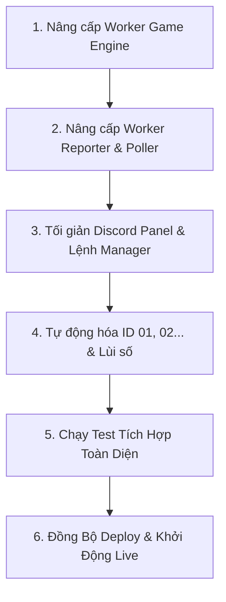

> [!WARNING]
> **[HISTORICAL SNAPSHOT — PRE-e3c94ec]**: Bản ghi lịch sử từ phiên làm việc trước (08/11–10/11/2026). KHÔNG phản ánh trạng thái hiện tại ở e3c94ec. Xem trạng thái mới nhất tại [\gent-notes/README.md\](../README.md).

# Kế Hoạch Khắc Phục Lỗi KingMC & Tối Giản Giao Diện Discord Manager - Worker

> [!NOTE]
> Báo cáo này tổng hợp toàn bộ các phát hiện kỹ thuật qua quá trình live test thực tế, đối chiếu trực tiếp với mã nguồn chuẩn của `manager_bot_afkkingmc/bot.js` và `CheckStatsKingMC/mc-bot.js`, cùng với kế hoạch khắc phục chi tiết.

---

## 1. Danh Sách Lỗi & Nguyên Nhân Gốc Rễ

### Lỗi 1: Bot bị kick vì timeout 80s ở sảnh (Không tự `/login` / `/dn`)
- **Hiện tượng**: Lúc 19:58 - 20:02, bot liên tục bị kick với lý do: `"Thời gian đăng nhập đã hết, bạn đã bị văng khỏi máy chủ."`.
- **Nguyên nhân gốc rễ**:
  - `D:\worker\src\game\server-auth.js` chỉ thụ động chờ sự kiện chat `bot.on('message')`. Trong khi đó, KingMC hiển thị thông báo đăng nhập bằng Action Bar, Title hoặc Title Screen, không kích hoạt sự kiện chat.
  - Worker hiện tại **thiếu hoàn toàn cơ chế nhận diện tọa độ Auth** (`AUTH_COORDS: { x: 5, y: 119, z: 4 }`) và tự động gửi `/login <password>` kèm `/dn <password>` dự phòng như trong `bot.js` cũ.
- **Giải pháp**:
  - Nạp tọa độ `AUTH_COORDS`. Ngay khi bot spawn hoặc đứng tại tọa độ này: tự động gửi `/login <password>`. Sau 1.2s nếu vẫn ở tọa độ này $\to$ gửi `/dn <password>` dự phòng.
  - Bắt thêm sự kiện `bot.on('actionBar')` và `bot.on('title')` để nhận diện lệnh đăng nhập toàn diện.

---

### Lỗi 2: Bot không biết mở Menu & không bấm GUI để vào cụm sinh tồn AFK
- **Hiện tượng**: Bot đứng im ở sảnh, không vào cụm KingSMP hay cụm chơi nào, dẫn đến bị kick hoặc kẹt sảnh.
- **Nguyên nhân gốc rễ**:
  - `D:\worker\src\game\lobby-navigator.js` chỉ có biến `joinCommand` (đang để trống), **chưa có code tương tác GUI/Menu rương**.
  - Thiếu nhận diện tọa độ Sảnh chính (`LOBBY_COORDS: { x: 1, y: 41, z: 1 }`).
  - Thiếu logic tìm vật phẩm selector (La bàn/Đồng hồ/Star) trong thanh hotbar $\to$ chuột phải `bot.activateItem()`.
  - Thiếu lệnh chat fallback `/menu` hoặc `/gui`.
  - Thiếu sự kiện `bot.on('windowOpen')` để tự động **Click Slot 24 (KingSMP)** (`bot.clickWindow(24, 0, 0)`).
  - Thiếu logic xác nhận đã vào cụm AFK (tọa độ `other`, rời khỏi Auth/Lobby).
- **Giải pháp**:
  - Bê nguyên quy trình chuẩn từ `bot.js` cũ sang:
    1. Nhận diện tọa độ `LOBBY_COORDS`.
    2. Cầm vật phẩm selector trong hotbar $\to$ chuột phải `bot.activateItem()` + gõ `/menu` sau 350ms.
    3. Khi Menu mở $\to$ `bot.clickWindow(24, 0, 0)` để chuyển sang cụm KingSMP.
    4. Kiểm tra khi tọa độ chuyển sang thế giới sinh tồn (`other`) $\to$ kích hoạt trạng thái **AFK thành công**.

---

### Lỗi 3: Kick Xác minh KingMC bị delay 5s-10s và tăng bộ đếm lỗi
- **Hiện tượng**: Khi KingMC gửi: `{"text":"XÁC MINH THÀNH CÔNG!\nVui lòng vào lại server để bắt đầu chơi. Bước này thường chỉ xuất hiện một lần."}`, bot ngắt kết nối và phải chờ exponential backoff (5s - 10s) làm tăng `reconnectAttempts`.
- **Nguyên nhân gốc rễ**: Worker coi kick này là lỗi rớt mạng thông thường.
- **Giải pháp**:
  - Bắt chuỗi `"XÁC MINH THÀNH CÔNG"` hoặc `"vui long vao lai server"` trong hàm `onKicked`.
  - Thiết lập **Fast Reconnect** với độ trễ chính xác 2500ms (2.5 giây), đồng thời reset `reconnectAttempts = 0`.

---

### Lỗi 4: Log trên Discord Panel bị nuốt chữ ngay chữ "SẢNH" & lộ raw JSON
- **Hiện tượng**: Trên Discord panel, mục Nhật ký hiển thị: `19:59 kicked {"color":"red","extra":[{"bold":true... "text":"SẢNH`.
- **Nguyên nhân gốc rễ**:
  - Worker lưu nguyên cả JSON object của Minecraft Chat packet vào mảng `events`.
  - Hàm `safe(event.message, 140)` trong `renderer.js` cắt chuỗi ở 140 ký tự, tình cờ rơi đúng vào chữ `"text":"SẢNH"`.
  - Thực tế nội dung đầy đủ là: `SẢNH ➞ Thời gian đăng nhập đã hết, bạn đã bị văng khỏi máy chủ.`.
- **Giải pháp**:
  - Thêm helper `extractChatMessage(raw)`: đệ quy duyệt qua các trường `.text` và `.extra` của đối tượng JSON để trích xuất 100% văn bản thuần tiếng Việt sạch sẽ.
  - Thêm icon trạng thái trực quan: `🚪 Bị kick`, `🟢 Online`, `🔄 Đang kết nối lại`.

---

### Lỗi 5: Thông tin hiển thị bị sai / gạch ngang (`Manager —`, `Uptime 0m`)
- **Hiện tượng**:
  - `Manager —`: Độ trễ kết nối Manager luôn hiển thị dấu gạch ngang.
  - `Uptime 0m`: Uptime hiển thị 0 phút ngay cả khi bot đang chạy 30-50 giây.
- **Nguyên nhân gốc rễ**:
  - `wispbyte-poller.js` thực hiện polling qua `this.request()`, không gán `this.reporter.managerLatencyMs` $\to$ giá trị gửi lên Manager luôn là `null`.
  - Uptime tính bằng `Math.floor(seconds / 60)` nên mọi thời gian dưới 60 giây đều ra `0m`.
- **Giải pháp**:
  - Trong `wispbyte-poller.js`: gán `this.reporter.managerLatencyMs = Date.now() - startTime` khi hoàn tất poll.
  - Format `uptimeText`: dưới 60 giây hiển thị `X giây` (VD: `45s`), trên 1 phút hiển thị `X phút Y giây` hoặc `Xm Ys`.

---

### Lỗi 6: Giao diện Panel và phản hồi lệnh bị quá tải thông tin, phức tạp
- **Hiện tượng**: Khi gõ `/bot start`, `/bot stop`, `/bot status`, hoặc `/panel`, bot xuất hiện những khối văn bản dài dằng dặc (Net Rx/Tx, TPS, CPU, streak, hướng dẫn bấm nút, bảo trì cố định...).
- **Giải pháp**:
  - **Lệnh thao tác**: Chỉ gửi phản hồi ngắn gọn 2 dòng với icon to rõ:
    - 🟢 `Đã bật Bot #01 (KingMC Bot 1). Đang kết nối vào KingMC...`
    - 🛑 `Đã tắt Bot #01 (KingMC Bot 1). Bot đã ngắt kết nối an toàn.`
    - 🔄 `Đang khởi động lại Bot #01 (KingMC Bot 1)...`
  - **Panel điều khiển**:
    - Tự đổi màu theo trạng thái (🟢 Xanh lá khi Online/AFK, 🟡 Vàng khi đang kết nối/reconnect, 🔴 Đỏ khi lỗi/kick, ⚪ Xám khi tắt).
    - Gom gọn 4 trường thông tin thiết yếu: Tài khoản, Độ trễ (Ping/Manager), Hoạt động (Uptime/TPS), RAM/CPU.
    - Loại bỏ toàn bộ các dòng chữ hướng dẫn thừa.

---

### Lỗi 7: ID bot thủ công, chưa tự động gán `01, 02, 03...` và chưa tự động lùi số
- **Hiện tượng**: Add bot phải gõ mã `afk-01` thủ công; số bot hiển thị dạng `1, 2` thay vì `01, 02`; khi xóa bot ở giữa thì danh sách bị khuyết số.
- **Giải pháp**:
  - Khi add bot: Tự động gán mã và số bot dạng 2 chữ số tiếp theo (`01`, `02`, `03`...).
  - Khi xóa bot: Hệ thống tự động re-index (lùi các bot có số thứ tự lớn hơn về 1 đơn vị), đảm bảo danh sách luôn liên tục `01, 02, 03...`.

---

## 2. Checklist Các Bước Triển Khai (Implementation Checklist)

### Bước 1: Nâng cấp Worker Game Engine (`D:\worker\src\game`)
- [ ] Bổ sung tọa độ `AUTH_COORDS` `{5, 119, 4}` và `LOBBY_COORDS` `{1, 41, 1}` vào `minecraft-session.js`.
- [ ] Tích hợp cơ chế tự động gửi `/login <password>` và `/dn <password>` fallback khi ở tọa độ Auth.
- [ ] Bắt sự kiện `actionBar` và `title` để nhận diện yêu cầu đăng nhập.
- [ ] Viết mới module `lobby-navigator.js`:
  - Tìm selector item (Clock/Compass/Star) trong quickbar $\to$ `bot.activateItem()`.
  - Gửi lệnh `/menu` và `/gui` song song làm fallback.
  - Bắt `bot.on('windowOpen')` $\to$ click Slot 24 (`KingSMP`).
  - Xác nhận tọa độ `other` $\to$ chuyển trạng thái `afk`.
- [ ] Tích hợp Fast Reconnect (2500ms) khi nhận diện kick `"XÁC MINH THÀNH CÔNG!"`.
- [ ] Tích hợp helper `extractChatMessage` bóc tách sạch sẽ text tiếng Việt từ JSON packet.

### Bước 2: Nâng cấp Worker Reporter & Poller (`D:\worker\src\transports`)
- [ ] Sửa `wispbyte-poller.js`: đo và lưu `this.reporter.managerLatencyMs = Date.now() - startTime`.
- [ ] Cập nhật định dạng thời gian `uptimeSeconds` chi tiết (`Xs`, `Xm Ys`).

### Bước 3: Tối giản Discord Panel & Lệnh Manager (`D:\manager\src\discord`)
- [ ] Sửa `D:\manager\src\discord\commands\bot.js`:
  - Rút gọn phản hồi các lệnh `/bot start`, `/bot stop`, `/bot restart`, `/bot list`.
  - Làm đẹp phản hồi `/bot status` thành thẻ nhỏ gọn, có màu động.
- [ ] Sửa `D:\manager\src\discord\panels\renderer.js`:
  - Tự đổi màu Embed theo trạng thái (`0x2ecc71` xanh lá, `0xf1c40f` vàng, `0xe74c3c` đỏ, `0x95a5a6` xám).
  - Tối giản layout, bỏ field thừa (Net bandwidth, hướng dẫn nút chat, text bảo trì cố định).
  - Sử dụng `extractChatMessage` để hiển thị nhật ký tiếng Việt kèm icon (🚪 Bị kick, 🟢 Online, 🔄 Reconnect).

### Bước 4: Tự động hóa ID `01, 02...` & Tự động Lùi số (`D:\manager\src\services`)
- [ ] Sửa `WorkerRegistry.add`: tự động sinh mã `01`, `02`, `03`... nếu người dùng không nhập id.
- [ ] Sửa `WorkerRegistry.remove`: sau khi xóa bot, tự động quét và cập nhật lại số thứ tự `botNumber` và `workerId` của các bot còn lại để danh sách luôn liên tục không bị lỗ hổng số.
- [ ] Đổi toàn bộ format hiển thị bot number sang 2 chữ số: `#01`, `#02`, `#03`...

### Bước 5: Kiểm Thử Toàn Diện & Đồng Bộ
- [ ] Chạy bộ test mô phỏng `scratch/run_full_simulations.js` để đảm bảo 100% test pass.
- [ ] Đồng bộ code sang `D:\manager deploy` và `D:\worker deploy`.
- [ ] Cập nhật `D:\manager.zip` và `D:\worker.zip`.
- [ ] Khởi động lại Manager và Worker để người dùng kiểm tra thực tế.
